<div align="center">

# vvg

**Every word is a painting.**

Type any word and vvg paints a one-of-a-kind artwork from it.<br>
Same word, same painting, on every machine, forever.

[](https://www.npmjs.com/package/@tiveor/vvg)
[](https://bundlephobia.com/package/@tiveor/vvg)
[](package.json)
[](LICENSE)

[**Try it in your browser**](https://tiveor.github.io/vvg) · [Use it from the terminal](#from-the-terminal) · [Use it in code](#in-your-code)

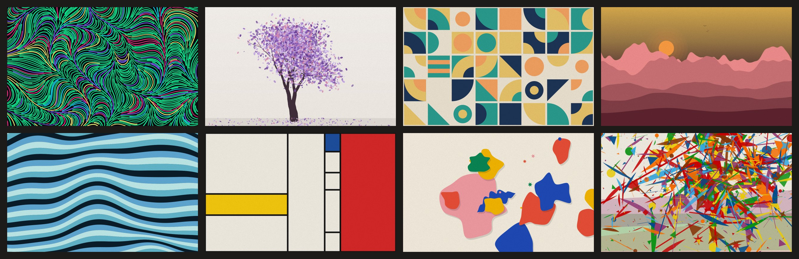

</div>

## From the terminal

```bash
npx @tiveor/vvg "your name"
```

That's it: `your-name.png` is your painting. Some more:

```bash
npx @tiveor/vvg tiveor --style flow --size wallpaper    # a 2560×1440 desktop wallpaper
npx @tiveor/vvg "Ada Lovelace" --size phone --palette neon
npx @tiveor/vvg --size og -o cover.svg                 # social card, as SVG
npx @tiveor/vvg sunday -n 6 --frame --sign "Me, 2026"  # six framed, signed variations
npx @tiveor/vvg --list                                 # every style, palette and size
```

| Option | |
|---|---|
| `-s, --style` | `flow` `bauhaus` `jacaranda` `horizon` `chaos` `mondrian` `blobs` `waves` |
| `-p, --palette` | 17 curated palettes, see `--list` |
| `-z, --size` | `WxH` or `wallpaper` `4k` `phone` `square` `og` `banner` `avatar` `a4` |
| `-o, --out` | `.png` or `.svg` |
| `-n, --count` | paint several variations |
| `-g, --grain` | paper grain from `0` to `1` |
| `-f, --frame`, `--sign` | gallery mat and a signature |

PNG output uses [`canvas`](https://github.com/Automattic/node-canvas) when it's installed. Without it, vvg writes SVG.

## In your code

```bash
npm i @tiveor/vvg
```

```js
import { paint } from "@tiveor/vvg";

const art = paint({ seed: "Ada Lovelace" });

art.svg();       // a standalone SVG string: works in Node, the browser, edge functions
art.draw(ctx);   // or paint onto any 2D canvas context
art.style;       // "blobs": the seed picked it
art.palette;     // "whipala"
```

Everything is optional:

```js
paint({
  seed: "Ada Lovelace",   // any text or number; random if omitted
  style: "flow",          // picked by the seed if omitted
  palette: "ocean",       // picked by the seed if omitted
  width: 1600,
  height: 1000,
  grain: 0.12,            // paper texture, 0 turns it off
  frame: true,            // gallery mat
  signature: "Ada, 1843",
});
```

Changing only the palette keeps the composition, so you can recolor a painting without losing it.

### In the browser, no build step

```html
<canvas id="art" width="1600" height="1000"></canvas>
<script type="module">
  import { paint } from "https://esm.sh/@tiveor/vvg";
  paint({ seed: location.hostname }).draw(document.getElementById("art").getContext("2d"));
</script>
```

### In Node, as PNG

```js
import { createCanvas } from "canvas";
import { writeFileSync } from "node:fs";
import { paint } from "@tiveor/vvg";

const art = paint({ seed: "hello", width: 1920, height: 1080 });
const canvas = createCanvas(art.width, art.height);
art.draw(canvas.getContext("2d"));
writeFileSync("hello.png", canvas.toBuffer("image/png"));
```

## Ideas

- **Default avatars** that look like art: `paint({ seed: user.id, width: 256, height: 256 }).svg()`.
- **Cover images** for blog posts, seeded by the slug, so each post keeps its picture.
- **A new wallpaper every day**: `npx @tiveor/vvg "$(date +%F)" -z wallpaper`.
- **Placeholders** that are nicer than grey boxes.
- **Gifts**: print someone's name as an A4 painting, framed and signed (`-z a4 -f --sign`).

## Styles

| | | |
|---|---|---|
| 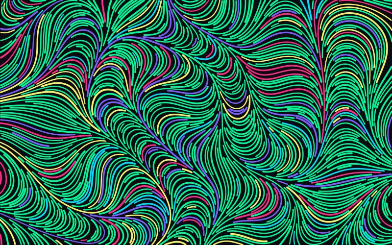 **flow**: lines that follow an invisible current and never cross | 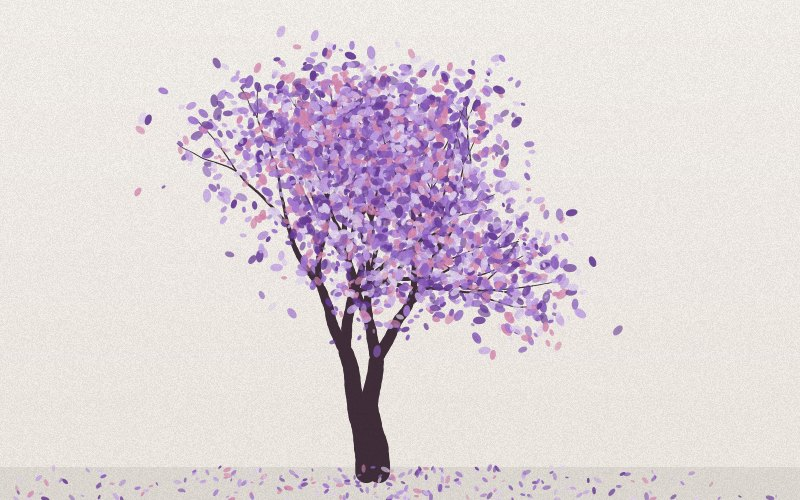 **jacaranda**: a tree in full bloom, grown branch by branch | 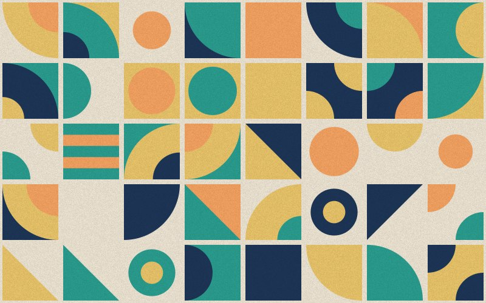 **bauhaus**: quarter circles, half moons and triangles |
| 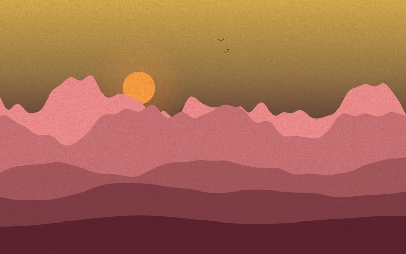 **horizon**: mountains fading into the distance under a low sun | 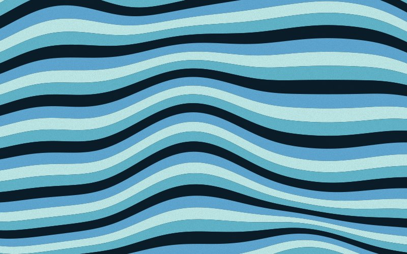 **waves**: undulating bands of color, op-art style | 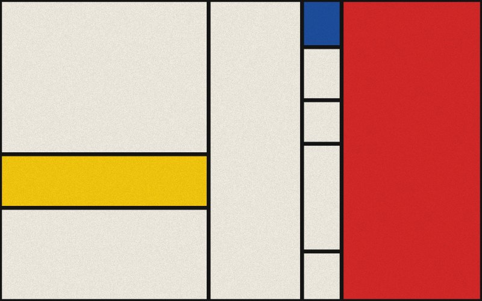 **mondrian**: recursive blocks and a few bold colors |
| 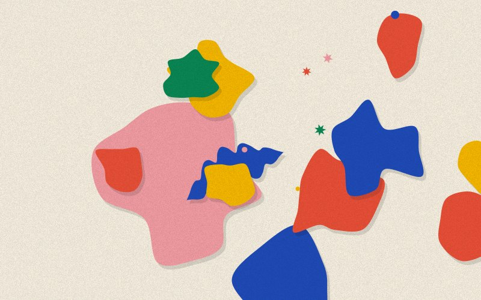 **blobs**: organic paper cut-outs, after Matisse | 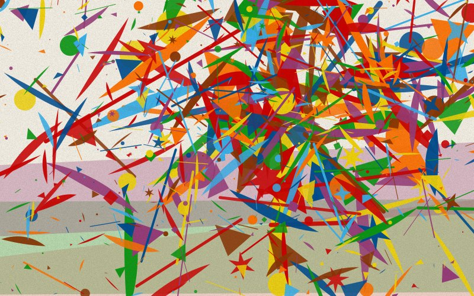 **chaos**: a storm of shards, the original vvg | |

## Make your own style

A style is a function that draws with a seeded `Painter`. Use `p.rng` for every random choice and the result stays reproducible.

```js
import { defineStyle, paint } from "@tiveor/vvg";

defineStyle({
  name: "confetti",
  description: "Dots, lots of them",
  draw(p) {
    p.background();
    for (let i = 0; i < 400; i++) {
      p.circle(p.rng.float(0, p.width), p.rng.float(0, p.height), p.rng.float(2, p.unit / 30), {
        fill: p.color(),
        alpha: p.rng.float(0.6, 1),
      });
    }
  },
});

paint({ seed: "party", style: "confetti" }).svg();
```

`Painter` gives you `rect`, `circle`, `ellipse`, `wedge`, `polygon`, `line`, `curve` (smooth, through points), `star`, `path` and `text`. It also has `rng` (`float`, `int`, `chance`, `pick`, `gauss`, `shuffle`), 2D simplex `noise`, the current `palette`, `color()` and `unit` (the short side, so styles scale). Add palettes with `definePalette({ name, background, ink, colors })`.

New styles are the best contribution you can make: see [CONTRIBUTING.md](CONTRIBUTING.md).

## How it works

The seed is hashed (cyrb53) into a small fast generator (mulberry32). The style draws into a flat list of shapes: rectangles, circles, wedges and Bézier paths. That list is rendered to SVG or to a canvas, so both outputs show the same painting. The playground animates the painting by drawing that list a little at a time.

## Inspiration

vvg began in 2019 as a random painter inspired by Marc Quinn's [Chaos Paintings](http://marcquinn.com/artworks/chaos-paintings) and Bert Ernie's [The Most Beautiful Man That Ever Lived](https://berternie.com). The `jacaranda` tree grows with a branching algorithm adapted from [Kenneth Jorgensen's canvas trees](http://kennethjorgensen.com/blog/2014/canvas-trees).

<p>
  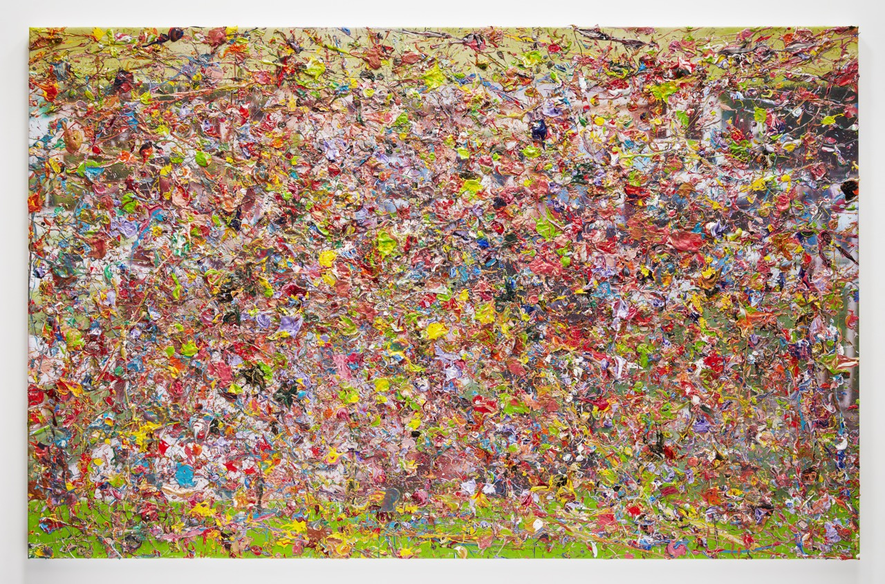
  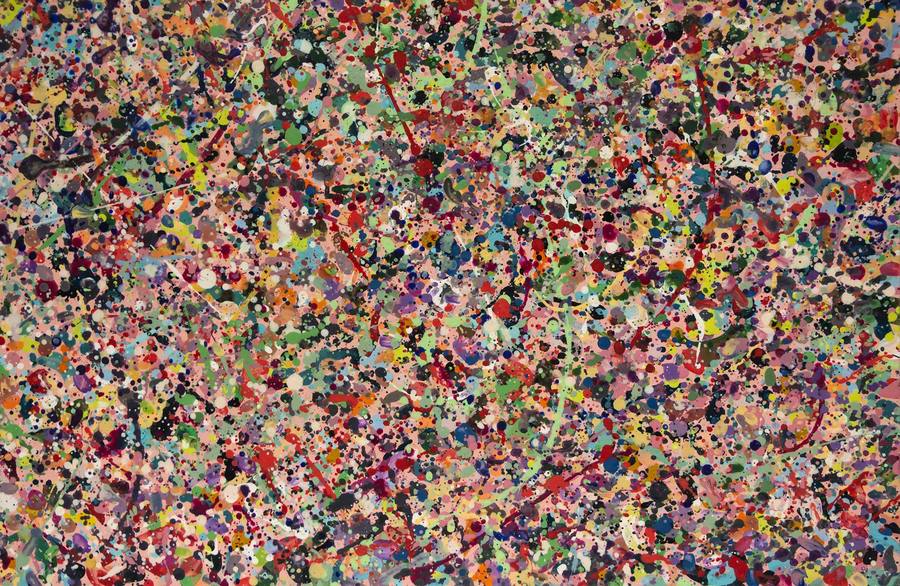
</p>

## License

MIT © Alvaro Orellana. The paintings you make are yours.
